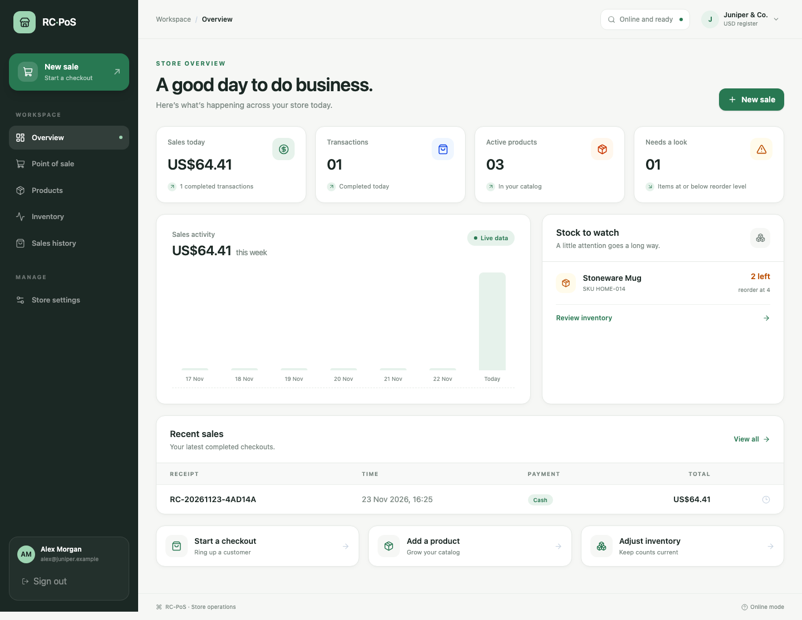
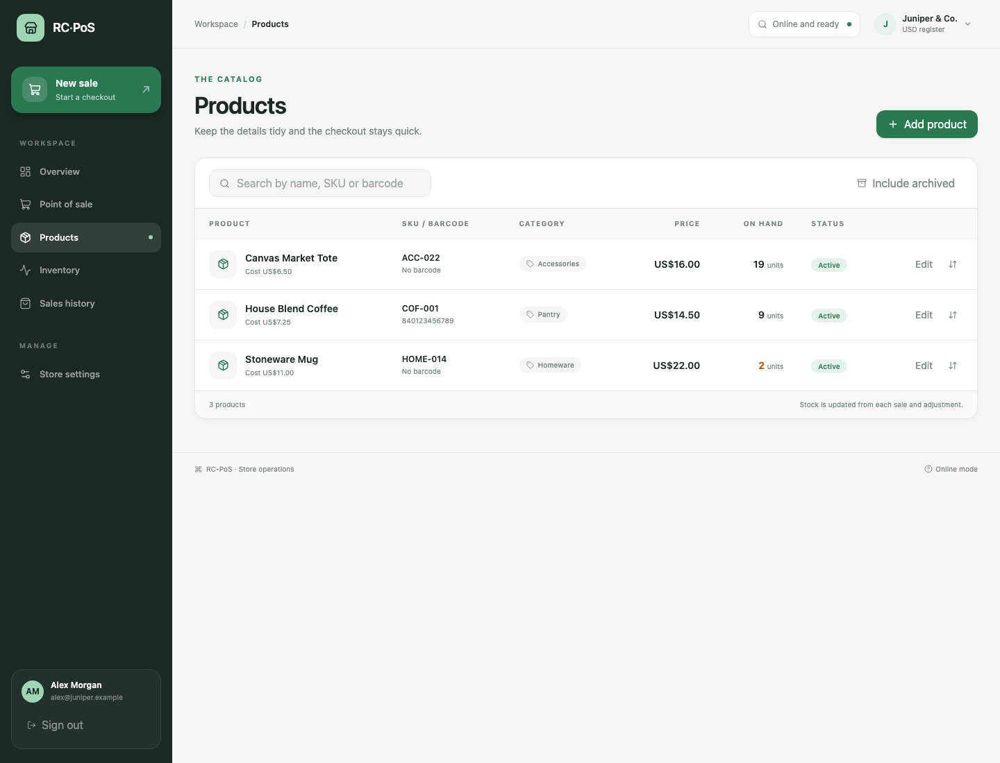
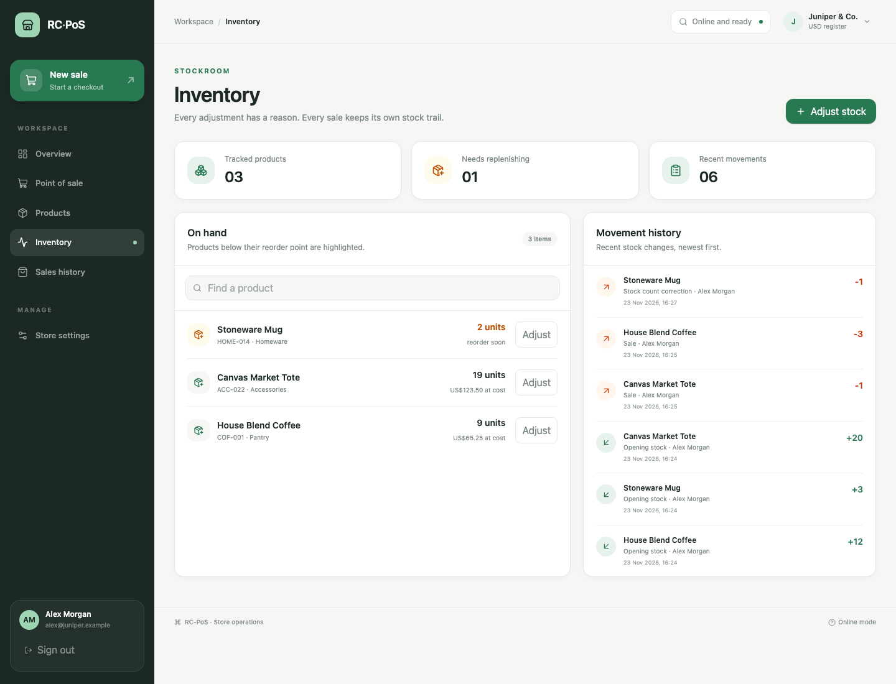
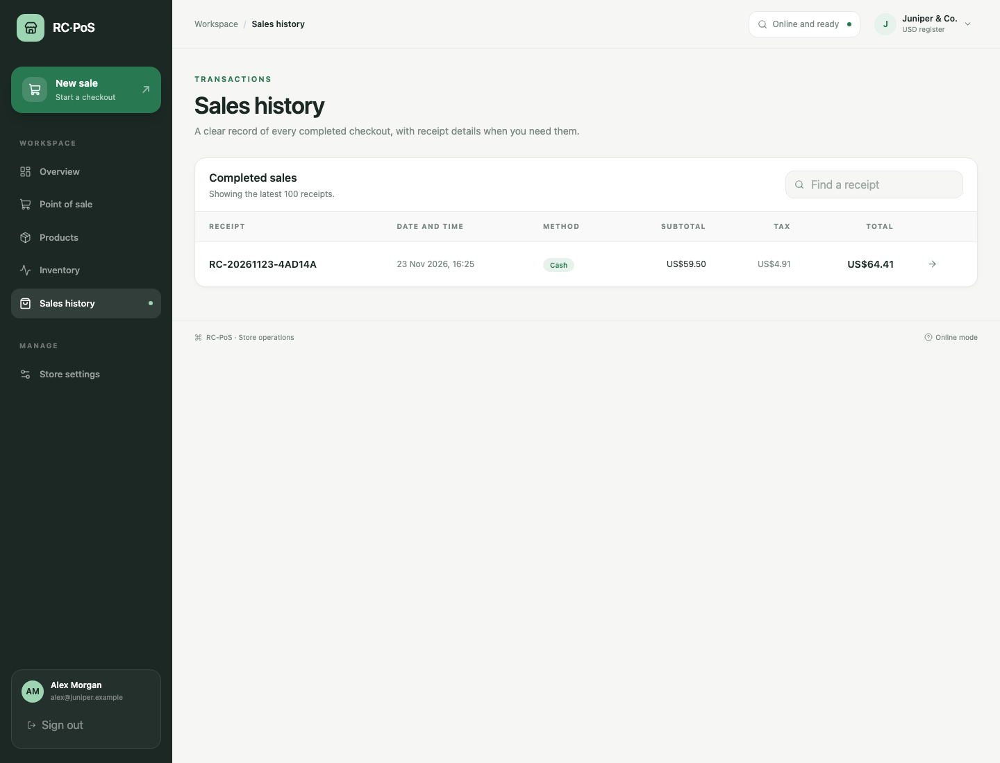
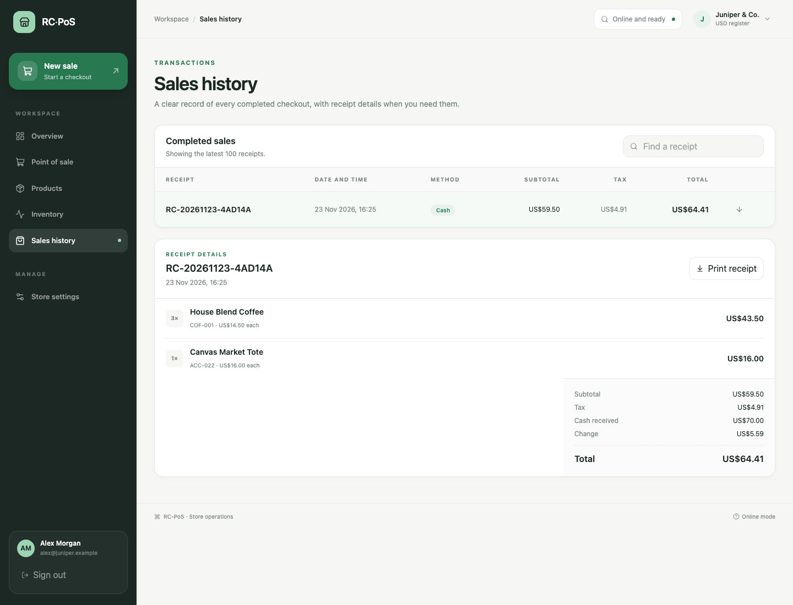

# RC-PoS

An online point of sale for independent retailers. RC-PoS is a full-stack Cloudflare Worker with a React and Tailwind interface and a D1 database. Each deployment owns its store data.



_A local demo store with a completed cash sale and sample inventory._

[](https://deploy.workers.cloudflare.com/?url=https://github.com/ranajahanzaib/rc-pos)

## What works

- One-time store setup with an administrator account, currency, and sales tax rate
- First-run administrator setup with a generated 256-bit access key and secure, expiring sessions
- Access-key rotation from store settings
- Product catalog with SKU, optional barcode, category, price, cost, starting stock, and reorder point
- Cash checkout with server-calculated prices and tax, stock validation, change due, and a receipt
- Idempotent checkout requests so a retry after a connection hiccup does not record the same sale twice
- Inventory adjustments and a stock movement history for openings, sales, and manual corrections
- Sales history with receipt line snapshots and printable receipts
- Dashboard summaries for today, recent sales, low stock, and the last seven days

This first release is online-only and accepts cash. Card processing, refunds, multiple registers, multiple stores, offline sales, and importing existing catalog data are not included.

## Screenshots

The screenshots below show the running app with disposable demo data.

| Product catalog                                                                                   | Inventory and movement history                                                            |
| ------------------------------------------------------------------------------------------------- | ----------------------------------------------------------------------------------------- |
|  |  |

| Sales history                                                                  | Receipt details with tax and change                                                       |
| ------------------------------------------------------------------------------ | ----------------------------------------------------------------------------------------- |
|  |  |

## Run locally

Requirements: Node.js and pnpm.

```sh
pnpm install
pnpm dev
```

`pnpm dev` applies pending D1 migrations to Wrangler’s local database before starting Vite and the Cloudflare Worker runtime. Open the local URL printed by Vite, then complete the one-time store setup form.

Useful commands:

```sh
pnpm typecheck
pnpm build
pnpm preview
pnpm db:migrate:local
```

## Deploy to your Cloudflare account

The Wrangler config declares a D1 binding and migrations directory. The Deploy to Cloudflare flow provisions the D1 database and fills in its ID. The build step creates the React app assets; the deploy script applies pending remote D1 migrations before deploying the Worker and assets.

For a manual first deployment, create a D1 database in your Cloudflare account and put its ID in `wrangler.jsonc`. Then run:

```sh
pnpm build
pnpm deploy
```

For later schema changes, add a new SQL file in `migrations/`. The deploy script applies unapplied migrations before deploying the Worker.

Cloudflare’s React/Vite integration runs the Worker locally during development and deploys the SPA assets with the API Worker. The `/api/*` routes are explicitly handled by the Worker while the remaining unknown routes use SPA navigation fallback.

## Data notes

- Prices are stored as integer minor units, not floating point values.
- Each sale keeps a snapshot of the SKU, item name, quantity, and unit price at checkout.
- Stock is constrained from going below zero and all sale, sale-line, and stock-movement writes happen in one D1 batch transaction.
- Product price edits do not alter past receipts.
- The generated access key is shown at setup, then stored only as a SHA-256 hash. Save it in a password manager; it cannot be recovered from the database. It can be rotated while signed in.
- Sessions are stored as token hashes. The browser cookie is HTTP-only, same-site, and secure on HTTPS.
- Dashboard day boundaries use UTC.

## Development

- React, TypeScript, Vite, Tailwind CSS
- Cloudflare Workers with Hono
- Cloudflare D1 and SQL migrations
- pnpm for dependency management

Dependency ranges are declared in `package.json`, and the lockfile records the resolved dependency graph for repeatable installs.

## License & Custom Work

[](mailto:work@withrana.com) [](https://www.linkedin.com/in/workwithrana)
[](https://www.upwork.com/freelancers/~01bbcf6edb91a8df5f)
[](https://contra.com/ranajahanzaib/)

**License:** MIT, see [LICENSE](LICENSE). Free for personal and commercial use.

**Author:** Rana Jahanzaib

**Need this built for your stack?** Email me what you're working on: work@withrana.com
